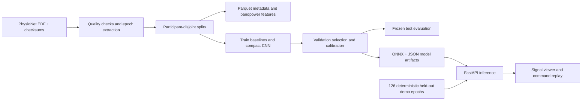

# IntentLab

**EEG decoding and command evaluation**

IntentLab explores how models recognise imagined hand movements in recorded EEG and measures the commands that follow from their predictions, with an interactive decoder, published experiments and reusable audits for saved prediction scores

[Open the experiment](https://intentlab-bci.vercel.app) · [New participant study](https://intentlab-bci.vercel.app/research/unseen) · [Audit commands](https://intentlab-bci.vercel.app/research/commands) · [Live API](https://intentlab-bci.vercel.app/docs) · [Learn the project](docs/WALKTHROUGH.md) · [Edit the website text](docs/EDITING.md)

[](https://github.com/shrut10/intentlab-bci/actions/workflows/ci.yml)

For students and educators, the [20-minute teaching exercise](docs/TEACHING.md) explains confidence, abstention and personal calibration through the demo. The [worked coverage audit](examples/coverage_audit.py) reconstructs operating points from saved predictions without downloading EEG or training a model. Reuse and methodological feedback are welcome through [the contribution guide](CONTRIBUTING.md).

The new [participant reliability audit](https://intentlab-bci.vercel.app/research/reliability) shows who receives commands, who receives none, errors among accepted predictions and participant-bootstrap uncertainty. You can [audit your own prediction CSV locally](docs/RELIABILITY.md) and open its report in the browser without uploading it. The [research roadmap](docs/ROADMAP.md) prioritises independent evaluation, causal processing and unintended-command assessment.

## What you can do

- Explore 126 real EEG epochs from 21 people excluded from training and model selection.
- Compare a compact neural network with signal-processing baselines through actual server-side inference.
- Change the confidence threshold, add repeatable noise or mask a processed channel.
- Inspect channel-occlusion explanations, frequency spectra, calibration and errors.
- Replay a six-trial sequence and see the trade-off between making a command and waiting.
- Trace every sample back to its public recording and reproduce the data pipeline and training.
- Audit saved predictions over time, including unwanted commands during instructed rest, missed cues, delays and gaps.

## Evaluation on new participants

The [Dreyer2023 study](https://intentlab-bci.vercel.app/research/unseen) uses 87 people in a separate public recording corpus, with 45 assigned to training, 15 to validation and 27 reserved for final evaluation; both the protocol and the model selection were committed before the corresponding analysis, and all source archives were checked against publisher hashes

The selected bandpower model reached **66.02% mean participant balanced accuracy** across 2,160 final trials, with a **95% participant bootstrap interval of 61.80% to 70.23%**, meeting the declared above chance criterion; the covariance comparison reached 67.78%, but its paired difference interval includes zero and does not change the original selection

At the fixed 0.75 fallback threshold, **347 of 409 accepted test predictions were correct**, giving 84.84% pooled accepted accuracy while retaining only 18.94% of trials; the validation target failed because four people had fewer than five accepted predictions, and the full participant table exposes the variation hidden by the pooled percentage

These are separately fitted models on cued imagery recordings with sham visual feedback, so the study supports a limited discrimination finding and does not externally validate the deployed PhysioNet CNN or establish reliable live control

[Methods and reproduction](experiments/unseen-v1/README.md) · [Exact participant split](experiments/unseen-v1/split_manifest.json) · [Predictions and provenance](artifacts/unseen-v1)

## Commands over time

In the new recorded session study, adding a task detector reduced commands during instructed rest from 5.8 to 0.9 per minute, while correct first commands fell from 189 of 400 movement cues to 71 of 400. Neither condition met its validation target. The result exposes the cost of suppressing commands and does not establish reliable live control.

The [session audit](https://intentlab-bci.vercel.app/research/commands) extends evaluation beyond individual predictions. It applies an explicit command policy to timestamped scores, then uses separate annotations to count correct responses, wrong commands, repeated responses and inactivity. Labels never drive the controller, and missing predictions are not filled in.

A separate exploratory study uses Zhou2016 recordings from four people, with session 1 for fitting, session 2 for policy selection and session 3 for evaluation. It compares movement confidence alone with the same classifier behind a task detector. Instructed rest is inferred from a documented protocol, while uncertain intervals remain unscored. The original deployed PhysioNet model is unchanged.

[Use your own CSV files](docs/COMMANDS.md) · [Frozen study protocol](experiments/command-replay-v1/PROTOCOL.md) · [Research and portfolio review](docs/RESEARCH_REVIEW_2026_11.md)

This is a **recorded-data research demo**, not a live headset, medical device or thought reader. It classifies experimental imagery labels. It does not decode dreams or measure consciousness.

## Actual results

All 327 selected recordings were verified against PhysioNet's published SHA-256 checksums. Prespecified quality checks retained **4,766 trials from 106 people**, split into 63 training, 22 validation and 21 test participants. There is no overlap of people between splits.

| Model | Validation balanced accuracy¹ | Test balanced accuracy¹ |
|---|---:|---:|
| Constant training-majority baseline | 50.0% | 50.0% |
| Log-bandpower + logistic regression | 54.1% | 58.7% |
| CSP + shrinkage LDA | 55.2% | 61.5% |
| Compact EEG CNN — selected on validation | **57.1%** | **61.1%** |

¹ Mean of each participant's balanced accuracy. CNN 95% participant-bootstrap interval: **55.8–66.6%**. These results are for this particular task and split, not comparable with within-person results or different movement classes.

The CNN was selected using validation performance, even though CSP scored slightly higher on the final test. Its architecture has **1,289 parameters** and its ONNX artifact is about **8 KB**.

**The reliability target was not met.** No validation threshold achieved 75% retained-trial accuracy while retaining at least 20% of trials and at least 100 examples. The declared fallback confidence threshold of 0.75 accepted only **27/945 test trials (2.9%)**, of which 24 were correct. That 88.9% figure is based on very few selected trials and is **not overall accuracy or evidence of reliable device control**. Most default replay steps intentionally stay still. Lowering the UI threshold is an exploratory experiment.

Removing C3 or C4 reduced test participant-macro balanced accuracy to **52.8%** and **52.9%** respectively. Channel sensitivity is consistent with the chosen sensorimotor montage, but does not establish a causal neural mechanism.

[Full metrics](artifacts/evaluation.json) · [Model card](docs/MODEL_CARD.md) · [Protocol recorded before training](docs/PROTOCOL.md) · [Data card](docs/DATA_CARD.md)

## Calibration and alignment follow-up

The [follow-up to issue #1](https://intentlab-bci.vercel.app/research/adaptation) compares a matched baseline, ten-trial personal temperature scaling, Euclidean alignment, and their combination across three training seeds. Evaluation uses later runs from the same 21 test participants, with all conditions, uncertainty and command coverage reported. This is an exploratory comparison on an already inspected benchmark; the original deployed model and the results above are unchanged.

[Study protocol and reproduction guide](experiments/adaptation-v1/README.md) · [Archived results](artifacts/adaptation-v1/evaluation.json) · [Prediction data](artifacts/adaptation-v1/predictions.parquet)

The [runnable MOABB example](examples/moabb_chronological/README.md) demonstrates a custom chronological splitter: ten early target trials for adaptation, unused early trials excluded, and later runs reserved for evaluation. It uses generated data and tests both labelled and unlabelled calibration routing; it is an integration example rather than a new EEG benchmark.

## Learning from unlabelled EEG

The [pretraining follow-up](https://intentlab-bci.vercel.app/research/pretraining) tests masked-channel reconstruction before movement classification, using only the original source-training people and a matched randomly initialised model. Three fixed seeds and two supervised-label budgets are reported in full. This is an exploratory analysis on the existing validation cohort, with no new test-set result or change to the live decoder. [Protocol and reproduction](experiments/pretraining-v1/README.md) · [Archived outputs](artifacts/pretraining-v1).

Pretraining did not improve this configuration: mean participant balanced accuracy was 52.51% versus 53.73% from scratch with 252 labels, and 55.43% versus 56.18% with all 2,832 source labels. These means cover three seeds and 22 validation participants; the report includes paired participant intervals, all predictions and the limitations of an already inspected cohort.

The accompanying [NoMAD data-access audit](docs/NOMAD_DATA.md) records the provenance, licence and published checksums of a separate intracortical dataset. Its recording downloads were unavailable during this review; no NoMAD or Neuralink recordings are used by the EEG model.

The demo distinguishes server processing from browser round-trip time and the three-second recorded input. To measure a deployment reproducibly, run `python scripts/benchmark_latency.py --url https://intentlab-bci.vercel.app --requests 20 --output /tmp/intentlab-latency.json`. The report separates first-observed and measured requests, reports p50/p95 and failures, and does not label the first request a controlled cold start.

## Architecture



**Training:** Python, MNE, NumPy, SciPy, scikit-learn, PyTorch, Parquet.

**Serving:** FastAPI, ONNX Runtime, NumPy/SciPy, plain HTML/CSS/JavaScript, Vercel.

**Engineering:** Docker with non-root user, GitHub Actions, automated data/model/API tests, checksum checks at startup, strict input schemas and bounded requests. No paid model API, account or API key is required to use the demo.

## Run locally

Python 3.12 is the tested version. Run from the repository root:

```sh
python3 -m venv .venv
source .venv/bin/activate
pip install -r requirements-dev.txt
python -m uvicorn app:app --reload
```

Open `http://127.0.0.1:8000`. Published artifacts are bundled; you do not need to download raw data or train a model to run the app.

```sh
pytest -q
ruff check .
ruff format --check .
node --check web/app.js
python scripts/smoke_test.py
```

Or use Docker:

```sh
docker build -t intentlab-bci .
docker run --rm -p 8000:8000 intentlab-bci
```

## Reproduce the experiment

Read the [protocol](docs/PROTOCOL.md) first. Downloads total approximately 796 MiB; processed training epochs require approximately 90 MiB. Training ran on a CPU. Package dependencies require additional disk space.

```sh
pip install -r requirements-training.txt
python scripts/prepare_data.py
python scripts/train.py --overwrite
```

`--overwrite` is explicit because a frozen evaluation is already included. Use it to reproduce the same experiment, not to tune against its test set. Subsequent acquisition can use `python scripts/prepare_data.py --offline`. Source hashes, quality exclusions and split IDs are in [manifest.json](data/derived/manifest.json). CPU/backend differences may slightly change floating-point outputs; this is one training seed, not a multi-seed benchmark.

To check cached source files without regenerating data or retraining, run `python scripts/audit_edf_timing.py`. This verifies their hashes, file structure and continuous EDF+C record timestamps. Preparation now stops on unsupported timing or gaps before writing derived outputs. The [filtering and recording-time note](docs/FILTERING.md) explains the exact existing two-pass filter and these later safeguards; the deployed model and original results are unchanged.

## API example

```sh
curl https://intentlab-bci.vercel.app/api/predict \
  -H 'Content-Type: application/json' \
  -d '{"trial_id":"S010-R04-E01","threshold":0.75,"noise":0.0}'
```

| Endpoint | Purpose |
|---|---|
| `GET /health` | Model readiness, version and artifact integrity |
| `GET /api/overview` | Cohort, channels, model selection and headline results |
| `GET /api/trials` | Available recordings and source metadata |
| `GET /api/trials/{id}` | Display signal and recorded cue |
| `GET /api/trials/{id}/csv` | All 480 normalised samples for a demo epoch |
| `POST /api/predict` | Live model inference, abstention, spectrum and occlusion |
| `GET /api/evaluation` | Frozen validation/test results and robustness analysis |
| `GET /api/adaptation` | Archived calibration/alignment comparison |
| `GET /api/adaptation/predictions` | Downloadable trial-level predictions for that comparison |
| `GET /api/pretraining` | Archived validation-only masked-channel pretraining results |
| `GET /research/pretraining` | Methods, generated result tables and primary research sources |
| `GET /research/unseen` | Separate Dreyer2023 study with 27 reserved test participants |
| `GET /api/unseen` | Archived participant scores, validation selection and uncertainty |
| `GET /docs` | Interactive API specification |

The public API accepts only bundled trial IDs and bounded perturbations. It does not accept private EEG uploads. The recorded label is returned for comparison **after** inference and is not a model input.

## Read and modify

| File | Start here for |
|---|---|
| [web/index.html](web/index.html) | Homepage wording, headings, explanations and field notes |
| [web/app.js](web/app.js) | Dynamic messages, controls and charts |
| [web/styles.css](web/styles.css), [web/base.css](web/base.css) | Appearance, colours and responsive layout |
| [src/intentlab/signal.py](src/intentlab/signal.py) | Shared signal transforms |
| [scripts/train.py](scripts/train.py) | Models, calibration and evaluation |
| [src/intentlab/inference.py](src/intentlab/inference.py) | Production inference without PyTorch |
| [src/intentlab/api.py](src/intentlab/api.py) | API routes and request validation |

See [Editing](docs/EDITING.md), [Walkthrough](docs/WALKTHROUGH.md) and [Operations](docs/OPERATIONS.md) for practical instructions.

## Sources and licences

Data: Schalk, G. (2009). *EEG Motor Movement/Imagery Dataset*, v1.0.0. PhysioNet. [doi:10.13026/C28G6P](https://doi.org/10.13026/C28G6P). Data and database derivatives are attributed under **ODC-BY 1.0**. See [NOTICE.md](NOTICE.md) for the required citations and data licence.

The compact CNN is **inspired by EEGNet**, not an exact reproduction: Lawhern et al. (2018), *EEGNet: A Compact Convolutional Network for EEG-based Brain-Computer Interfaces*. [Paper](https://arxiv.org/abs/1611.08024).

Original application code is MIT licensed. The MIT licence does not replace the dataset's licence. Built by Shruthi with AI coding assistance; the recorded experiments and source provenance are inspectable.

## Research report

The [on-site research report](https://intentlab-bci.vercel.app/research) describes the methods, compares every fixed candidate, and critically assesses generalisation, calibration, abstention and signal perturbations, with eight academic/data references and a downloadable BibTeX bibliography. It is an independent project report rather than a peer-reviewed publication. Source: `web/research.html`; editing guide: [docs/EDITING.md](docs/EDITING.md). Automated checks verify the published comparison table against the archived results.
